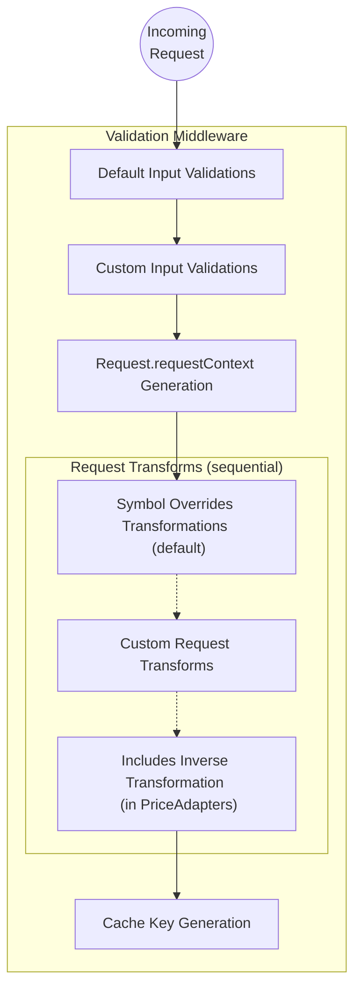

# Adapter

The adapter is initialized in the root-level `index.ts` file. It is configured using parameters set by the developer of the particular EA. These parameters are described in the sections below.

For EA's specific to retrieving price data, the framework provides a `PriceAdapter` class that standardizes types and has the added `includes` feature (covered [here](#includes)). The `PriceAdapter` class requires that at least one of the endpoints is a `PriceEndpoint` (covered in the [Endpoints Guide](./endpoints.md)).

## Default Endpoint

The default endpoint parameter is a string set to the name of one of the adapter endpoints. Requests will direct to this endpoint if the `endpoint` input parameter is not specified. The adapter will NOT fallback to this default if an incorrect endpoint name is explicitly defined in the request.

## Custom Settings

The v3 framework allows developers to define env vars that are specific to their EA. They should be defined in the `/config/index.ts` file in the format below.

If the EA does not require any custom env vars, this file can be ignored. Instead using the type `SettingsMap` from `@chainlink/external-adapter-framework/config`, where applicable, would be sufficient.

```typescript
import { AdapterConfig } from '@chainlink/external-adapter-framework/config'

export const config = new AdapterConfig({
  API_KEY: {
    description: '', // Description of the env var
    type: 'string', // What type should the value be
    options: ['foo', 'bar'], // If applicable, a list of valid options this env var could be set to
    default: 'foo', // If applicable, a default value
    validate: {
      meta: {},
      fn: () => {},
    }, // If applicable, a Validator object to validate the env var value. Return an error message for a failed validation, or undefined if it passes.
    required: true, // If the env var should be required. Default = false
    sensitive: false, // Set to false if the env var is safe to show uncensored in logs or telemetry. Default = true
  },
})
```

## Env Var Default Overrides

**Only use if absolutely necessary**

The adapter allows framework level env var defaults to be overriden. Framework level env vars have reasonable defaults already set so this parameter should not be needed for most adapters. Also, it should not be used to override defaults for custom settings since those should be specified directly in the custom settings object.

## Rate Limiting Tiers

Data provider specific rate limit tiers can be specified as one of the adapter parameters. They are defined by seconds, minutes, and/or hours. The tiers would then be selected using the `RATE_LIMIT_API_TIER` env var by setting it to the name of the tier.

## Overrides

Overrides are defined in the `/config/overrides.json` file. They allow input parameters to be overriden from a generic symbol to something more specific for the data provider such as an ID. An example of the format is below.

```json
{
  "adapterName": {
    "ETH": "1234"
  }
}
```

To understand where the overrides are applied, please refer to the [Request Validation & Transformation Diagram](#request-validation--transformation)

## Includes

The includes list, defined in the `/config/includes.json` file, is a parameter only for the `PriceAdapter`. In the v3 framework's current implementation, it is only used for inverses. This feature allows data to be retrieved for the inverse of pairs that a data provider does not support.

The most common example of this is for foreign exchange rates. Some data providers will only support pairs in one direction such as USD/JPY but not JPY/USD. To provide data for both directions, we can add an entry for this pair in the includes list like below. A request for JPY/USD is then rewritten to USD/JPY, and the inverse of the result is served from an inverse cache entry (`<raw cache key>-inverse`) that the transport writes next to the raw one. Nothing is inverted when the response is read.

The includes step only rewrites the pair. Whether the inverse is served is decided by the request middleware, in
the same place as the `inversion` flag (see [Request-driven inversion](#request-driven-inversion)). The order is
unchanged: symbol overrides, then the adapter's own request transforms, then the includes lookup and pair rewrite.

```json
[
  {
    "from": "JPY",
    "to": "USD",
    "includes": [
      {
        "from": "USD",
        "to": "JPY",
        "inverse": true
      }
    ]
  }
]
```

An endpoint that has inverse pairs in `includes.json` must use a transport that extends
`SubscriptionTransport` and has no `foregroundExecute`, and must not have a custom `cacheKeyGenerator`.
Requests for those pairs return 400 otherwise.

To understand where the inverses are applied, please refer to the [Request Validation & Transformation Diagram](#request-validation--transformation)

## Request-driven inversion

Inversion is opt-in per request with a boolean flag, and applied on the cache-write path:

```json
{
  "endpoint": "forex",
  "data": {
    "base": "USD",
    "quote": "JPY",
    "inversion": true
  }
}
```

`false` or an absent field means no inversion. Any other value (`"true"`, `1`, `null`, an object) is a 400.

| Endpoint                            | Fields inverted                                                 | Notes                            |
| ----------------------------------- | --------------------------------------------------------------- | -------------------------------- |
| `ForexPriceEndpoint` / single-value | `result` → `1 / result`; `data.result` is set to the same value | top-level `result` is the source |
| `LwbaEndpoint` / quote              | `bid' = 1 / ask`, `ask' = 1 / bid`, `mid' = 1 / mid`            | `bidSize`/`askSize` swap         |

Only `ForexPriceEndpoint` and `LwbaEndpoint` support inversion out of the box. A plain `PriceEndpoint` has no inverter,
and any other endpoint opts in by passing `invertResponse` in its endpoint params. An inverter only does the math: it
receives the `data` and `result` of a successful response and returns the inverted pair. Value checks do not belong in
it — they belong in the endpoint's `resultValidator`.

The order of operations on a write is:

1. The raw result is validated with the endpoint's `resultValidator`.
2. If it is an error, the same error is copied to the inverse entry unchanged.
3. Otherwise the result is inverted and validated again with the same `resultValidator`.

So an inverse value that fails validation becomes a 502 at the inverse key without affecting the raw value, and a
`resultValidator` or inverter that throws also becomes a 502 there. `bidSize`/`askSize` are swapped; size validity
belongs to the asset-class policy (OPDATA-9200).

Raw values are validated too: `ForexPriceEndpoint` returns 502 for a result that is zero or not a finite number, and
`LwbaEndpoint` returns 502 for non-finite prices. A negative price result is cached as it is.

### Cache keys and feed IDs

- No `inversion`, or `inversion: false`: the existing key, feed ID, and `includes.json` behavior.
- Enabled: the inverse entry is stored under the raw cache key plus the `-inverse` suffix, so the key is derived from
  the raw key and no request path computes a cache key twice. The inverse feed ID is computed from the request params
  plus `inversion: true`, so raw and inverse variants have distinct feed IDs. Those params are only ever built to
  compute a feed ID; they never reach a provider.
- Custom `cacheKeyGenerator`: 400, because the custom key may not distinguish variants.
- `inversion` is a reserved input parameter name, so an adapter cannot declare a param with that name.

### Transports and rollout

- Any transport that extends `SubscriptionTransport` and has no `foregroundExecute` supports inversion with no code
  changes: each transport owns a second subscription set for inverse requests, and results are written through the
  response cache as usual.
- Transports with `foregroundExecute`, and the composite transport, return 400.
- `inversion: true` on a pair that includes already inverts is the same as not sending the flag: the inverse is
  served.
- Inversion creates a new feed identity. Upgrade writers, then readers, then enable inversion. Inverse requests are
  tracked in a separate subscription set, so writer pods on an older framework version never see them: inverse requests
  time out until the writers are upgraded.

### Breaking changes

- `PriceAdapter.handleRequest` no longer inverts, and `requestContext.priceMeta` is gone; nothing replaces it on the
  request context. An adapter that needs its own "inverse without being asked" rule sets `endpoint.invertsByDefault`,
  and `endpoint.pairRewrite` if it also rewrites the pair.
- The includes rewrite is no longer an entry in `endpoint.requestTransforms`. It still runs after all of them.
- Inverse pairs from includes get a new cache key and a new feed ID (computed from the rewritten params plus
  `inversion: true`).
- A plain `PriceEndpoint` has no result validation, so an inverse of `0` is cached as it is (`Infinity`), the same
  value the read path used to return.
- A plain `PriceEndpoint` in an adapter with includes still rejects `inversion: true`.

## Request Transforms

**Only use if absolutely necessary**

Request transforms is an array of functions that allow the transformation of input parameters. The functions are provided with the incoming `AdapterRequest` object that can be altered and passed on to either another function or the rest of the adapter's logic.

Below is an example of a request transform function that uses the incoming request and transforms it by replacing `base` and `quote` with a new `hash` field.

Note: This component should not be used for overrides and inverses.

```typescript
export const requestTransform = (
  req: AdapterRequest<TypeFromDefinition<typeof inputParameters.definition>>,
): void => {
  const base = req.requestContext.data.base
  const quote = req.requestContext.data.quote
  if (base && quote) {
    req.requestContext.data.hash = hash(`${base}${quote}`)
    delete req.requestContext.data.base
    delete req.requestContext.data.quote
  }
}
```

To understand where these transformation apply, please refer to the [Request Validation & Transformation Diagram](#request-validation--transformation)

## Bootstrap Function

**Only use if absolutely necessary**

The bootstrap function is custom logic a developer can specify to run at the startup of the adapter.

One use case, shown below, is to perform validations on combinations of env vars. An error is thrown on failure to halt the adapter startup.

```typescript
export const adapter = new Adapter({
  ...
  bootstrap: async (adapter: Adapter<typeof customSettings>) => {
    if (adapter.config.WS_ENABLED && !adapter.config.WS_API_KEY) {
      throw 'WS_API_KEY is required when WS_ENABLED is set to true'
    }
  },
  ...
})
```

## Request Validation & Transformation

This diagram expands on the `Validation Middleware` section of the `EA v3 Design` diagram in [Basics](../basics.md#ea-v3-design)


